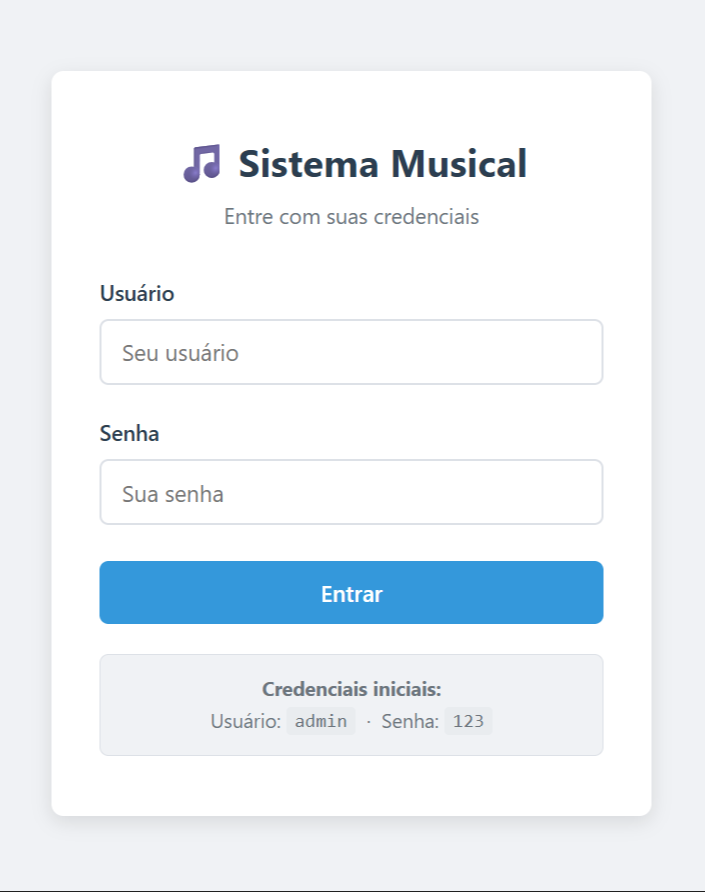
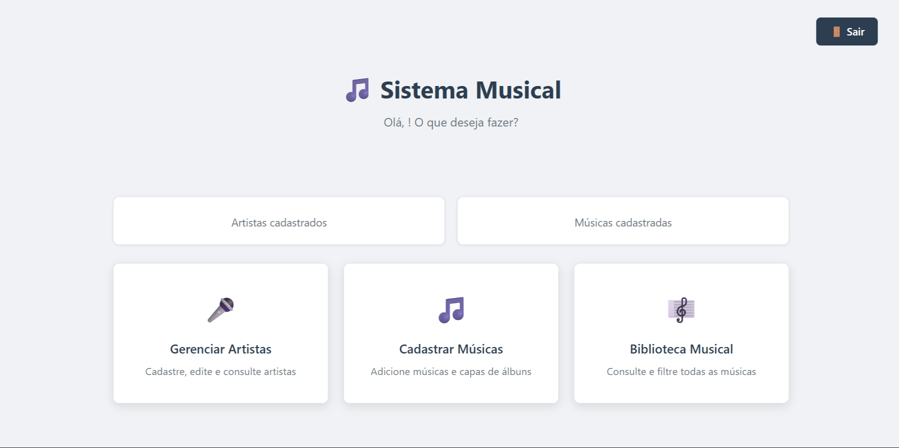
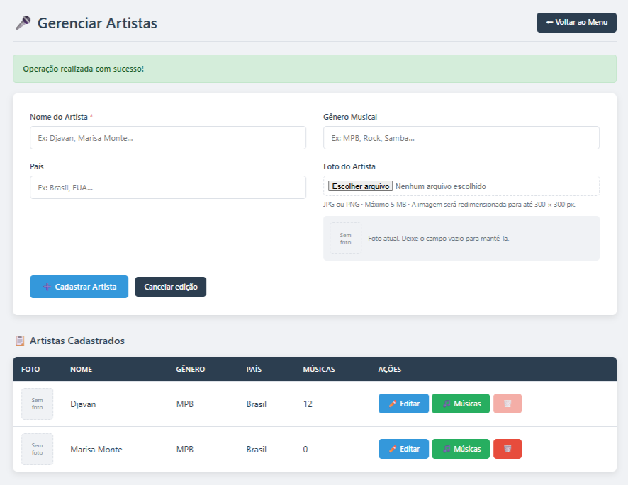
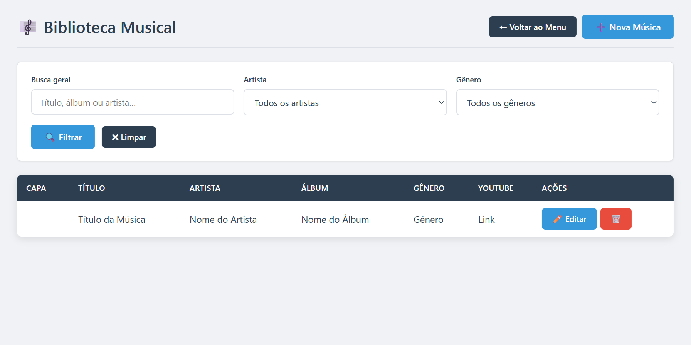
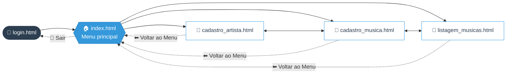

<!-- ═══════════════════════════════════════════════════════════════
     🎵 SISTEMA MUSICAL — Aulas 11, 12, 13 e 14 · SENAI · 1ID-DS
═══════════════════════════════════════════════════════════════ -->

<a id="top"></a>

<div align="center">


<a href="https://github.com/SEU-USUARIO/NOME-DO-REPOSITORIO">
  
</a>

<br/>


<br/>

**[🚀 Começar](#-como-executar) · [🖥️ Telas](#telas) · [🎨 Paleta](#paleta) · [📱 Responsivo](#responsivo) · [👥 Equipe](#equipe)**

</div>

<br/>

---

<a id="sobre"></a>
## ✨ Sobre o projeto

> *"A música é a linguagem universal — e todo bom acervo começa com uma boa organização."* 🎶

O **Sistema Musical** é o front-end de um catálogo onde você cadastra **artistas** (os criadores) e **músicas** (as obras) e consulta tudo em uma biblioteca com **busca e filtros**.

Nesta etapa o foco é a **interface**: HTML semântico, **um único `styles.css`** com a paleta no `:root`, formulários com validação nativa do navegador e um layout que se adapta do computador ao celular. Os formulários já estão prontos (`method`, `action`, `name`, `required`) para serem ligados a um back-end nas próximas etapas.

<div align="center">

| 🖥️ | 🎨 | 📱 | 🧩 | 🚫 |
|:---:|:---:|:---:|:---:|:---:|
| **5 telas** | **1 CSS único** | **2 breakpoints** | **15 variáveis** no `:root` | **0 frameworks** |
| login ao catálogo | paleta centralizada | 768px e 600px | cores, sombras, raio e fonte | só HTML e CSS |

</div>

---

<a id="tema"></a>
## 🎼 Tema do catálogo

<div align="center">

| Conceito da atividade | No nosso projeto | Dados cadastrados |
|:---------------------:|:----------------:|:------------------|
| 🎤 **Criador** | **Artista** | nome · gênero musical · país · foto |
| 🎵 **Obra** | **Música** | título · artista · álbum · gênero · capa · link do YouTube |
| 🎼 **Listagem** | **Biblioteca Musical** | tabela com busca geral e filtros por artista e gênero |

</div>

---

<a id="telas"></a>
## 🖥️ As 5 telas

<div align="center">

| # | Tela | Arquivo | Função |
|:-:|:-----|:--------|:-------|
| 1️⃣ | 🔐 **Login** | [`login.html`](login.html) | Entrada no sistema com usuário e senha |
| 2️⃣ | 🏠 **Menu principal** | [`index.html`](index.html) | Painel com contadores e atalhos |
| 3️⃣ | 🎤 **Cadastro do criador** | [`cadastro_artista.html`](cadastro_artista.html) | Formulário de artista + tabela de cadastrados |
| 4️⃣ | 🎵 **Cadastro da obra** | [`cadastro_musica.html`](cadastro_musica.html) | Formulário de música e capa do álbum |
| 5️⃣ | 🎼 **Listagem** | [`listagem_musicas.html`](listagem_musicas.html) | Biblioteca com filtros e ações |

</div>

<div align="center">

<table>
<tr>
<td align="center" width="33%"><a href="prints/login.png"></a><br/><sub><b>🔐 Login</b></sub></td>
<td align="center" width="33%"><a href="prints/index.png"></a><br/><sub><b>🏠 Menu</b></sub></td>
<td align="center" width="33%"><a href="prints/cadastro_artista.png"></a><br/><sub><b>🎤 Artista</b></sub></td>
</tr>
<tr>
<td align="center"><a href="prints/cadastro_musica.png"></a><br/><sub><b>🎵 Música</b></sub></td>
<td align="center"><a href="prints/listagem_musicas.png"></a><br/><sub><b>🎼 Listagem</b></sub></td>
<td align="center"><sub>🖱️ Clique em qualquer print<br/>para ampliar</sub></td>
</tr>
</table>

</div>

> 👇 Clique em cada tela para ver o **print** e os detalhes.

<details>
<summary><b>1️⃣ &nbsp;🔐 Login</b> — <code>login.html</code></summary>

<br/>

<div align="center">


<sub>📸 Tela de login do Sistema Musical</sub>

</div>

- 💳 Card centralizado na tela, com cabeçalho e dica de acesso
- ✅ Campos **obrigatórios** (`required`): tentar entrar vazio mostra o aviso do navegador
- 🔑 Foco automático no campo de usuário (`autofocus`)
- 🔒 Campo de senha com `type="password"` e `autocomplete` configurado

</details>

<details>
<summary><b>2️⃣ &nbsp;🏠 Menu principal</b> — <code>index.html</code></summary>

<br/>

<div align="center">


<sub>📸 Menu principal com os atalhos do sistema</sub>

</div>

- 📊 **Cartões de estatística** com a quantidade de artistas e músicas
- 🧭 **Três cartões de navegação** (ícone + título + descrição) em grade
- 🚪 Botão **Sair** que volta para o login
- 📱 No celular, os cartões passam para **1 coluna**

</details>

<details>
<summary><b>3️⃣ &nbsp;🎤 Cadastro do criador (artista)</b> — <code>cadastro_artista.html</code></summary>

<br/>

<div align="center">


<sub>📸 Cadastro de artista com tabela de cadastrados</sub>

</div>

- 🧱 Formulário em **grade de 2 colunas** (vira 1 coluna no celular)
- ⭐ Campo obrigatório marcado com `*` em vermelho (nome)
- 🖼️ Upload de foto aceitando **JPG e PNG**
- ✏️ **Editar** · 🎵 **Músicas** · 🗑️ **Excluir** (com confirmação antes de apagar)
- 🚫 Exclusão desabilitada quando o artista ainda tem músicas vinculadas

</details>

<details>
<summary><b>4️⃣ &nbsp;🎵 Cadastro da obra (música)</b> — <code>cadastro_musica.html</code></summary>

<br/>

<div align="center">


<sub>📸 Tela de cadastro da obra (música)</sub>

</div>

- 🧱 Mesmo padrão visual do cadastro de artista (reaproveita o `styles.css`)
- ⭐ Campos obrigatórios com validação nativa
- 🎤 Seleção do artista dono da música
- 🖼️ Upload da capa do álbum

</details>

<details>
<summary><b>5️⃣ &nbsp;🎼 Listagem (Biblioteca Musical)</b> — <code>listagem_musicas.html</code></summary>

<br/>

<div align="center">


<sub>📸 Biblioteca Musical com filtros e tabela</sub>

</div>

- 🔍 **Busca geral** por título, álbum ou artista
- 🎚️ Filtros por **artista** e **gênero**, combináveis entre si
- 🧹 Botão **Limpar** para zerar os filtros
- 📜 Tabela com **rolagem horizontal** no celular, sem quebrar o layout

</details>

---

<a id="navegacao"></a>
## 🧭 Fluxo de navegação



> ✅ Todas as telas internas têm o botão **⬅ Voltar ao Menu**, então dá para percorrer o sistema inteiro só pelos links.

---

<a id="paleta"></a>
## 🎨 Paleta de cores

Toda a identidade visual vive no bloco `:root` do [`styles.css`](styles.css). Mudou a variável, mudou o sistema inteiro. ✨

<div align="center">

| Cor | Variável | Código | Onde aparece |
|:---:|:---------|:------:|:-------------|
|  | `--primary` | `#2c3e50` | Títulos e destaques |
|  | `--blue` | `#3498db` | Botões primários e links |
|  | `--blue-dark` | `#2980b9` | *Hover* dos botões |
|  | `--green` | `#27ae60` | Mensagens de sucesso |
|  | `--red` | `#e74c3c` | Excluir e campos obrigatórios |
|  | `--red-dark` | `#c0392b` | *Hover* do excluir |
|  | `--bg` | `#f0f2f5` | Fundo das páginas |
|  | `--surface` | `#ffffff` | Cartões, formulários e tabelas |
|  | `--border` | `#dde1e7` | Bordas |
|  | `--text` | `#2c3e50` | Texto principal |
|  | `--text-muted` | `#6c757d` | Texto secundário |

</div>

<details>
<summary>🧪 <b>Ver o bloco <code>:root</code> completo</b></summary>

```css
:root {
    --primary:     #2c3e50;
    --blue:        #3498db;
    --blue-dark:   #2980b9;
    --green:       #27ae60;
    --red:         #e74c3c;
    --red-dark:    #c0392b;
    --bg:          #f0f2f5;
    --surface:     #ffffff;
    --border:      #dde1e7;
    --text:        #2c3e50;
    --text-muted:  #6c757d;
    --shadow-sm:   0 1px 3px rgba(0,0,0,.08);
    --shadow-md:   0 4px 12px rgba(0,0,0,.10);
    --radius:      8px;
    --font:        'Segoe UI', system-ui, -apple-system, sans-serif;
}
```

</details>

---

<a id="responsivo"></a>
## 📱 Responsivo de verdade

O projeto declara a `viewport` em todas as páginas e adapta o layout com *media queries* no próprio `styles.css`.

```text
  🖥️ COMPUTADOR                          📱 CELULAR
┌───────────────────────────┐          ┌──────────────┐
│ ┌───────┐ ┌───────┐ ┌───┐ │          │ ┌──────────┐ │
│ │ 🎤    │ │ 🎵    │ │🎼 │ │   ───►   │ │   🎤     │ │
│ └───────┘ └───────┘ └───┘ │          │ └──────────┘ │
│ [ campo ]   [ campo ]     │          │ ┌──────────┐ │
│ [ campo ]   [ campo ]     │          │ │   🎵     │ │
│ ┌───────────────────────┐ │          │ └──────────┘ │
│ │ tabela completa       │ │          │ ┌──────────┐ │
│ └───────────────────────┘ │          │ │   🎼     │ │
└───────────────────────────┘          │ └──────────┘ │
   grade em colunas                    │ [  campo   ] │
                                       │ [  campo   ] │
                                       │ ◄ tabela ►   │
                                       └──────────────┘
                                          1 coluna
```

<div align="center">

| Largura da tela | O que muda |
|:---------------:|:-----------|
| **`≤ 768px`** 📱 | Formulários em 1 coluna · filtros empilhados · menu em 1 coluna · tabelas com rolagem horizontal · botões e miniaturas menores |
| **`≤ 600px`** 📲 | Filtro de artista em coluna · cartões de estatística em 2 colunas |

</div>

> 💡 **Teste você mesmo:** abra qualquer tela, aperte **`F12`** e ative o **modo dispositivo (celular)**. Redimensione e veja o layout se adaptando.

---

<a id="estrutura"></a>
## 📂 Estrutura do repositório

Os arquivos do sistema ficam soltos na **raiz**, como pede a atividade (sem `.zip`). A pasta `prints/` guarda só as imagens deste README:

```text
📦 sistema-musical
 ┣ 📝 README.md               📖 Você está aqui
 ┣ 📄 cadastro_artista.html   🎤 Tela 3 — Cadastro do criador
 ┣ 📄 cadastro_musica.html    🎵 Tela 4 — Cadastro da obra
 ┣ 📄 index.html              🏠 Tela 2 — Menu principal
 ┣ 📄 listagem_musicas.html   🎼 Tela 5 — Listagem
 ┣ 📄 login.html              🔐 Tela 1 — Login
 ┣ 🎨 styles.css              ✨ Único arquivo de estilos
 ┗ 📁 prints/                 📸 Capturas de tela usadas neste README
```

<details>
<summary>🧱 <b>Como o <code>styles.css</code> está organizado</b></summary>

<br/>

| Seção | Conteúdo |
|:-----:|:---------|
| 1 | Variáveis (`:root`) e reset |
| 2 | Formulários (base reaproveitada por todas as telas) |
| 3 | Botões |
| 4 | Componentes de mensagem |
| 5 | Tela de login |
| 6 | Layout base (`.container`) |
| 7 | Menu principal |
| 8 | Tipografia |
| 9 | Cabeçalho de página com ações |
| 10 | Formulário em grade (2 colunas) |
| 11 | Tabelas |
| 14 | Filtros |
| 15 | Utilitários |
| 16 | Responsividade |
| 17 | Elementos adicionais (estatísticas, formulários inline) |

</details>

---

<a id="como-executar"></a>
## 🚀 Como executar

<table>
<tr>
<td width="60">

### 1️⃣

</td>
<td>

**Baixe o projeto**

```bash
git clone https://github.com/SEU-USUARIO/NOME-DO-REPOSITORIO.git
cd NOME-DO-REPOSITORIO
```

</td>
</tr>
<tr>
<td>

### 2️⃣

</td>
<td>

**Abra o `login.html`** no navegador (duplo clique) ou use a extensão **Live Server** do VS Code.

</td>
</tr>
<tr>
<td>

### 3️⃣

</td>
<td>

**Entre com as credenciais de teste**

| Usuário | Senha |
|:-------:|:-----:|
| `admin` | `123` |

</td>
</tr>
<tr>
<td>

### 4️⃣

</td>
<td>

**Navegue pelas 5 telas** usando os links e botões. 🎉

</td>
</tr>
</table>

> 📦 Não precisa instalar nada: sem Node, sem build, sem frameworks. Só HTML e CSS.

---

<a id="checklist"></a>
## ✅ Checklist da atividade

<div align="center">

| Requisito | Status |
|:----------|:------:|
| 🗄️ Repositório público no GitHub | ✅ |
| 📤 Arquivos soltos na raiz (sem `.zip`) | ✅ |
| 🖥️ 5 telas: login, menu, cadastro do criador, cadastro da obra e listagem | ✅ |
| 🎨 Um único `styles.css` com a paleta no `:root` | ✅ |
| 📱 Funciona no computador e no celular | ✅ |
| 👥 Nomes dos integrantes em comentário no topo do `login.html` | ✅ |
| 🔗 Navegação entre todas as telas pelos links | ✅ |
| 🚫 Validação de campo vazio com `required` | ✅ |

</div>

---

<a id="proximos"></a>
## 🔮 Próximos passos

- [x] 🎨 Interface das 5 telas
- [x] 📱 Layout responsivo
- [x] 🧪 Validação nativa dos formulários
- [x] ⚙️ Back-end para salvar os dados
- [x] 🗃️ Banco de dados de artistas e músicas
- [x] 🔐 Login com autenticação real
- [x] 🖼️ Redimensionamento das imagens no servidor
- [x] 🔎 Filtros funcionando com os dados salvos

---

<a id="faq"></a>
## ❓ Perguntas frequentes

<details>
<summary><b>Por que os dados da tabela são só exemplos?</b></summary>

<br/>

Esta etapa entrega o **front-end**. As linhas da tabela são modelos para mostrar como a interface ficará. Os formulários já têm `method`, `action` e `name` configurados, então a ligação com o back-end vem nas próximas aulas.

</details>

<details>
<summary><b>Tem JavaScript no projeto?</b></summary>

<br/>

Quase nada. O único trecho é o `confirm()` que pergunta **"Deseja realmente excluir?"** antes de apagar um artista ou uma música. Todo o resto (validação, layout, responsividade) é HTML e CSS puros.

</details>

<details>
<summary><b>Como mudo as cores do sistema?</b></summary>

<br/>

Edite as variáveis no `:root` do `styles.css`. Como todas as telas usam essas variáveis, a mudança vale para o sistema inteiro de uma vez.

</details>

<details>
<summary><b>Como testo no celular?</b></summary>

<br/>

No navegador, aperte **F12**, clique no ícone de **dispositivo** e escolha um modelo de celular (ou arraste para redimensionar). Se ativar o **GitHub Pages** no repositório, dá para abrir o site direto no seu telefone também.

</details>

---

<a id="equipe"></a>
## 👥 Equipe

<div align="center">

| 👨‍💻 |
|:---:|
| **Vinycius Lopes Monteiro da Silva** |
| Desenvolvimento de Sistemas |
| Turma 1ID-DS | Turma 1ID-DS |

<br/>

🏫 **SENAI** — Desenvolvimento de Sistemas · 👨‍🏫 **Professor:** Raul Porto Lopes

</div>

---

<div align="center">

### 🎶 Feito com HTML, CSS e muita música pela equipe do Sistema Musical

⭐ *Se gostou do projeto, deixe uma estrela no repositório!* ⭐

<a href="#top">⬆️ Voltar ao topo</a>


</div>
